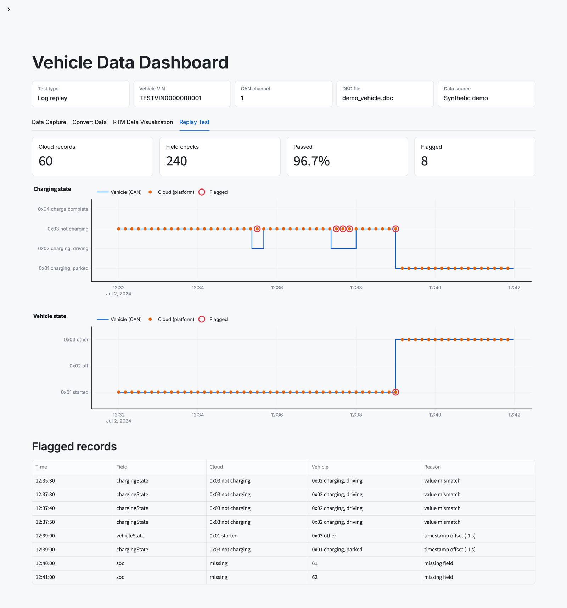
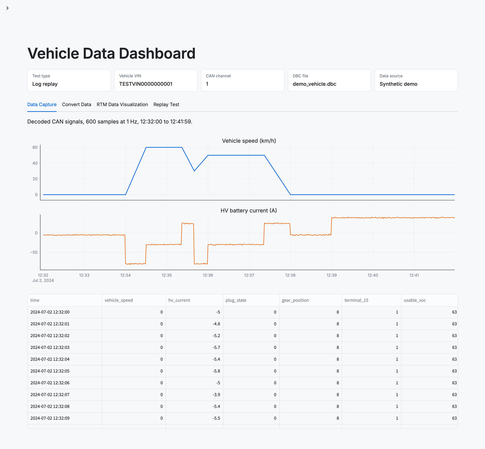

# EV telemetry validation dashboard

A demo rebuild of the validation tool I built during my 2024 internship at Porsche Engineering in Shanghai. It checks that what a car's telematics box uploads to the cloud matches what the car itself saw on the CAN bus, under GB/T 32960, China's mandatory EV telemetry standard.

All data here is synthetic. The original tool ran against real vehicles, CAN hardware and the internal telematics platform, none of which are included.



## Why

Every EV sold in China reports its state (speed, charging state, state of charge and more) to a monitoring platform every few seconds. Before that data goes live, test engineers have to confirm the telematics box encodes each field correctly. The manual way was to replay a drive log in CANoe and compare values against the platform export by hand: slow, and easy to miss a mismatch.

## What it does

1. **Capture** — decode CAN signals, live or from a recorded log, into a time series
2. **Derive states** — turn raw signals into the GB/T 32960 status codes the cloud should report: charging state, vehicle state, SOC
3. **Convert** — platform export (JSON lines) → CSV → SQLite, one table per GB/T 32960 data type
4. **Validate** — align each cloud record to the nearest vehicle sample and check every field:
   - field mapping: which signal feeds which cloud field, with unit conversion (m/s to km/h)
   - completeness: every required field is present
   - timestamp alignment: a cloud value that matches the vehicle a few seconds earlier or later is flagged as an offset, not a wrong value
   - value consistency within a per-field tolerance

The demo session hides three kinds of problems the tool was built to catch: regenerative braking reported as "not charging", states sampled late at ignition-off, and uploads with a missing field.



## Results of the original tool

- Replaced manual log comparison with one-click replay and checks; validation turnaround dropped by about 30%
- Shaped with the test engineers through weekly demos and adopted across the test team

## Run it

```
pip install -r requirements.txt
streamlit run app.py
```

## Files

- `app.py` — Streamlit dashboard: configuration, data capture, conversion, RTM data visualization, replay test
- `states.py` — GB/T 32960 state rules
- `checks.py` — validation rules
- `pipeline.py` — JSON → CSV → SQLite conversion
- `demo_data.py` — synthetic drive, park and charge session
